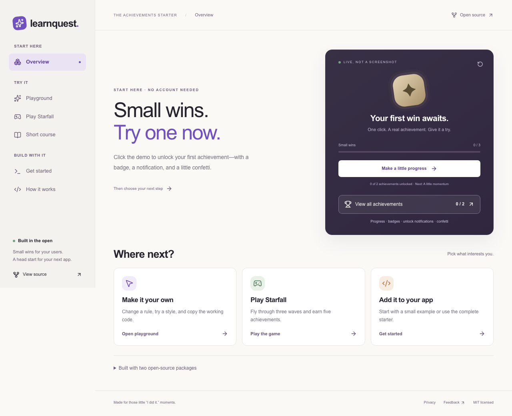
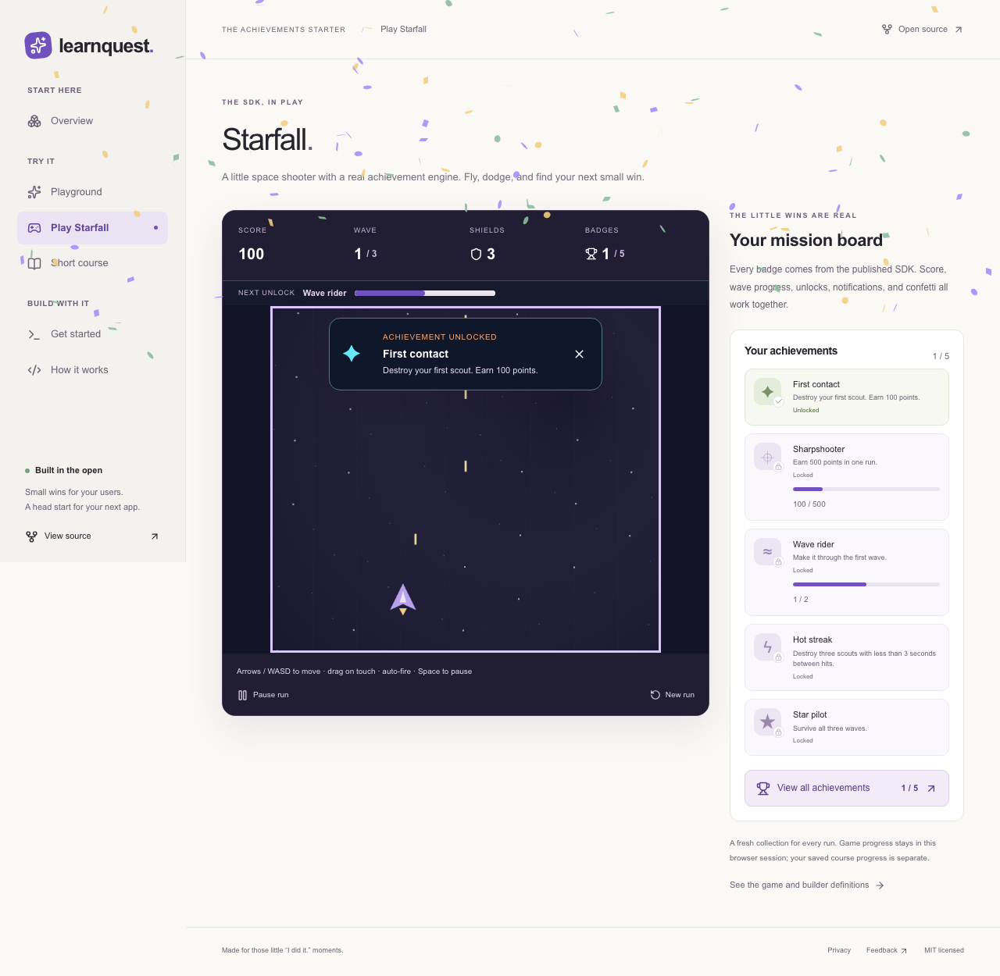

# Achievements Starter

A Next.js reference application and interactive playground for [achievements-engine](https://github.com/dave-b-b/achievements-engine) and [react-achievements](https://github.com/dave-b-b/react-achievements).

**[Try the live demo](https://achievements-starter.vercel.app)** — deployed on Vercel Hobby with Supabase Free. Play the Starfall space shooter, explore the builder playground, and read lessons without an account, or sign in with GitHub to save course progress. Guided tours start automatically on your first visit. See [verification status](docs/verification.md).



## Run locally

Use Node.js 24:

```sh
npm ci
npm run dev
```

Open **http://127.0.0.1:3417**. No credentials are needed to explore. See the [full setup guide](docs/setup.md) for authentication and persistence, the [free deployment guide](docs/deployment.md), and [verification status](docs/verification.md).

## What we're building

**LearnQuest** is the example application: a short course that teaches developers to add achievements to an app while demonstrating saved progress and achievement unlocks.

| Experience    | Behavior                                                                                                                               |
| ------------- | -------------------------------------------------------------------------------------------------------------------------------------- |
| `/playground` | Try three presets without signing in, change thresholds and appearance, trigger achievements, and copy a complete working integration. |
| `/arcade`     | Play Starfall: move your ship, dodge scout fire, clear three waves, and earn five SDK achievements without signing in.                 |
| `/learn`      | Read three short lessons, sign in to save completion, unlock three milestones, and return to persistent progress.                      |

Confetti and unlock notifications are enabled in every demo. Prominent collection buttons show all locked and earned achievements, including progress toward numeric goals. The course collection is also available before sign-in.

The demo and exported examples use `AchievementBuilder` throughout. Guided tours start automatically on the first visit to the playground and setup pages. Visitors can skip them, and their browser remembers completion or dismissal. The guide buttons replay either tour at any time.

The starter consumes published SDK releases. It demonstrates authentication, database persistence, accessible UI, and safe retries without copying the SDK implementations into this repository.

## Starfall arcade

[Play Starfall](https://achievements-starter.vercel.app/arcade). Move with arrows or WASD, or drag your ship on touch. Firing is automatic; Space pauses. Real kills and wave clears feed the SDK: the next badge goal stays in the game HUD, and unlock notifications appear on the playfield when earned. The game pauses when hidden or when its collection opens. A new run resets only game state and game achievements; saved course progress is separate. Confetti respects reduced-motion preferences.

The simulation, collision rules, and builder definitions live in [`src/game`](src/game), and [`src/components/arcade.tsx`](src/components/arcade.tsx) connects gameplay events to the published SDK. It uses no game service, external asset host, account, or paid infrastructure.



## Start here

- [Product plan](docs/product-plan.md): audience, scope, flows, acceptance criteria, and adoption goals.
- [Architecture](docs/architecture.md): ownership, data flow, authentication, transaction boundaries, and verification.
- [Roadmap](docs/roadmap.md): implementation order and milestone issues.
- [Contributing](CONTRIBUTING.md): how to contribute during planning and implementation.
- [Issues](https://github.com/dave-b-b/achievements-starter/issues): implementation tasks and acceptance criteria.

## Stack

Next.js 16.4.3, React 19.3.1, TypeScript 6.0.3, Supabase Auth/Postgres, and Vercel Hobby. SDK versions are pinned at Engine 2.1.0 and React Achievements 6.0.0, with a committed lockfile.

The server-backed journey is: **sign in → complete one lesson → save progress and achievement state together → reload and see the result preserved**.

## Project boundaries

| Repository                                                             | Owns                                                                                                                           |
| ---------------------------------------------------------------------- | ------------------------------------------------------------------------------------------------------------------------------ |
| [achievements-engine](https://github.com/dave-b-b/achievements-engine) | Rule evaluation, achievement state, persistence contracts, and shared server contracts.                                        |
| [react-achievements](https://github.com/dave-b-b/react-achievements)   | React providers, hooks, widgets, and presentation.                                                                             |
| This repository                                                        | Lessons, authentication, database adapter and migrations, application routes, playground, deployment, and onboarding examples. |

SDK changes should be made in their owning repositories and linked from the issue that needs them. This application should use their published versions after those changes are released.

## License

[MIT](LICENSE).
