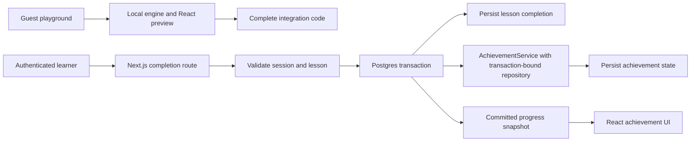

# Architecture

Status: implemented; provider verification and beta outcomes remain pending. Last updated: 2026-10-28.

## Ownership

The engine owns rule evaluation, achievement state, and persistence interfaces. The React package adapts that state into hooks and UI. This app owns lesson content, authenticated commands, database access, the playground, and deployment.

Consume published packages through public exports. The pinned pair is Engine 2.1.0 / React Achievements 6.0.0. Keep database-specific integration in this application for v1.

## Application structure

```text
app/
  learn/                    Public lesson pages and authenticated progress UI
  playground/               Guest configuration editor and preview
  arcade/                   Public Starfall space shooter
  api/                      Authenticated progress and completion routes
  auth/                     OAuth callback and session handling
src/
  achievements/             Shared definitions and client-safe types
  course/                   Fixed lesson definitions and validation
  server/                   Server-only auth, database access, and service wiring
  playground/               Presets, safe configuration model, and code export
  game/                     Bounded simulation, collisions, drawing, and builder definitions
supabase/migrations/        Schema, constraints, and access policies
tests/                      Focused database and browser scenarios
examples/minimal/           Browser-runnable local integration
```

This layout is a starting point, not a requirement to create empty directories. The minimal example may have its own manifest and lockfile; choose a workspace only if the implementation benefits from it.

## Two state paths



The guest preview uses memory state and no learning database writes. Saved learning progress is authoritative on the server.

## Authentication and authorization

Use Supabase Auth with a single OAuth method initially. Follow the supported server-side cookie and session validation flow. Validate authentication and authorization in every protected server operation, including snapshot reads. Never accept a subject ID from the request as proof of identity.

Keep database credentials and privileged client code server-only. Scope reads and writes to the validated user. Use access policies and grants that deny direct browser writes to authoritative completion and achievement tables. Test the actual browser-facing permissions, including attempted access to another user's records.

## Persistence model

Start with three application-owned tables:

| Table              | Purpose and invariants                                                                              |
| ------------------ | --------------------------------------------------------------------------------------------------- |
| Learner progress   | One durable row per authenticated user, used as the database lock target.                           |
| Lesson completions | User ID, known lesson ID, and completion time; unique on `(user_id, lesson_id)`.                    |
| Achievement state  | Engine-compatible state for one subject, plus a serialization/schema version for future migrations. |

The tables are `learners`, `lesson_completions`, and `achievement_states`; optional aggregate site counts use `daily_events`. Establish a single lock ordering for every command that changes a user's progress. A new learner row must be inserted safely before taking its row lock.

### Completion command

1. Validate the server session, request origin/CSRF protections, request schema, and known lesson ID.
2. Start one transaction on one database connection; safely ensure the learner row exists, then lock it for this user.
3. Insert lesson completion with the unique constraint handling duplicate requests.
4. Derive absolute metrics from persisted completions, such as `lessonsCompleted` and `courseCompleted`.
5. Construct a request-local `AchievementService` and repository bound to that transaction. Evaluate and persist achievement state through the engine's public API.
6. Commit both completion and achievement state before returning the canonical snapshot and `newlyUnlocked` result.

Absolute metrics make retries independent of a client-supplied increment. All writers must use the same database lock; an in-process mutex is insufficient across server instances.

The current repository interface offers a transaction callback without an explicit connection argument. Bind the app's repository to the existing transaction; its callback must reuse that transaction rather than opening a second independent one. Never send `BEGIN` through a shared pool and then issue work on unrelated connections. Separate REST writes do not provide this atomic boundary.

No queue or outbox is needed for v1 while completion and achievement state share a transaction. A future external side effect would need a separate delivery design.

### Client contract

Expose an app-owned authenticated completion command and snapshot read. Use a small React client adapter for these supported operations. Read-only lesson content stays public.

Do not expose generic client-supplied `/track`, `/increment`, or `/reset` operations for earned learning progress. The application derives authoritative metrics from completion records. Validate the event name and lesson ID; reject unsupported direct metric mutations.

Serialize learning mutations in the UI for v1, reconcile from the returned snapshot, and refresh on reload or focus. Retry displays must distinguish committed progress from network uncertainty. A retry can return no new unlocks after an earlier request already committed; persisted achievement state must still show the unlock. This release does not promise exactly-once notification delivery or realtime cross-tab updates.

## Builder definitions and guided onboarding

All demonstrated rule definitions use the published `AchievementBuilder` API. Numeric presets use `create().withMetric().withCondition().withAward().build()`; boolean milestones use `createBooleanAchievement().withAward().toConfig()`. Course milestones use distinct derived boolean metrics so combining builders cannot overwrite custom conditions under one metric key.

The app uses React Joyride 3.2.0 for playground and setup tours that start automatically on each page's first visit. The browser remembers completion or dismissal separately for each tour in local storage; blocked storage does not prevent starting, dismissing, or replaying a guide. Targets use explicit `data-tour` attributes. A tour button calls the real preview tracking function to demonstrate an unlock. Tour state is separate from preview resets and saved account progress. Skip, close, Escape, and replay are supported; scroll animation is disabled and focus trapping remains enabled. Tours are application UI, not an SDK requirement.

## Playground and code export

Use a bounded configuration model: numeric thresholds, boolean milestones, text labels, an icon allowlist, and supported theme choices. Never evaluate arbitrary pasted JavaScript. Escape exported string values and serialize from one configuration source so preview and generated code stay aligned.

Use the actual local engine and React components. Recreate preview state explicitly when definitions change. The existing provider initializes its engine once, so changing definition props alone is insufficient; key the provider by configuration revision and reset preview state predictably.

Preset changes and reset affect only the guest preview. Exports must include imports, definitions, provider setup, an action, and visible feedback. Offer both a minimal runnable example and the full authenticated starter.

## Starfall and celebration UI

Starfall is a local arcade example, independent of authenticated course progress. Its bounded animation steps own movement, projectile collisions, shield damage, wave transitions, and scoring. React forwards resulting score, combo, wave, and victory events through the SDK public API; builder definitions own award thresholds. The SDK owns achievement evaluation, snapshots, unlock dispatch, and real canvas confetti. A fresh memory-backed provider scopes each run. Backgrounding the game or opening its achievement collection pauses it. Keyboard and pointer/touch controls share the same simulation.

The app enables confetti and notifications in its home, playground, course, arcade, and exported examples. It supplies a styled notification through the public `NotificationComponent` extension and a native dialog through `ModalComponent`. The collection uses SDK `AchievementsWidget` and `AchievementsList`, shows locked and earned awards, reads numeric progress from engine snapshots, traps keyboard focus, and restores the trigger on close. The SDK confetti implementation respects reduced motion. Expired OAuth state is explained with a safe course retry link; public demos remain available.

## Deployment and dependency policy

Use the Next.js Node runtime for direct SQL operations. Select a maintained Postgres driver and configure the supported serverless pooler mode; use a single transaction connection for each completion command. Document migration connections separately from runtime connections.

Use isolated non-production data for previews. Commit migrations and an environment variable template containing names and safe placeholders only. Deployment instructions must cover authentication callback URLs, migrations, secrets, and verification. Hosting setup and production deployment are separate implementation work.

Release SDK changes only for demonstrated integration gaps: fix and release the engine first where necessary, then the React package, then update this app to published versions. Do not rely on unpublished sibling paths in the default starter.

## Verification

| Boundary                      | Required evidence                                                                                      |
| ----------------------------- | ------------------------------------------------------------------------------------------------------ |
| Published package integration | Clean install, type-check, build, and real unlock using the pinned versions.                           |
| Auth and access               | Anonymous mutation denied; two users isolated; direct database access policies exercised.              |
| Transactions                  | Duplicate lesson, concurrent different lessons, and cross-instance behavior preserve correct state.    |
| Rollback and retry            | Forced achievement-save failure rolls back completion; retry after a lost response remains idempotent. |
| UI                            | Loading, failure, retry, keyboard navigation, and reduced-motion behavior on the core journeys.        |
| Code export                   | Generated examples for each preset compile and unlock through the public SDK APIs.                     |
| Setup                         | A fresh developer follows the published minimal and full-app instructions.                             |

Use real Postgres for transactional scenarios; mocks cannot establish database locking or rollback behavior. Keep screenshots, demo links, and claims aligned with the verified release.

## Reference documentation

- [Next.js authentication](https://nextjs.org/docs/app/guides/authentication)
- [Supabase server-side authentication](https://supabase.com/docs/guides/auth/server-side/creating-a-client)
- [Supabase Postgres connections](https://supabase.com/docs/guides/database/connecting-to-postgres)
- [Next.js on Vercel](https://vercel.com/docs/frameworks/full-stack/nextjs)
